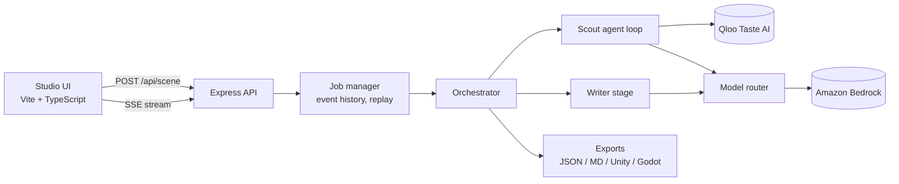

# Backlot

Backlot is a Qloo-powered agent that turns what people in a place actually love into evidence-linked, engine-ready game world content.

Give it a one-line brief such as "A 1990s Lagos detective adventure". An agent queries Qloo's Taste AI for the music, venues, brands, TV and games associated with that place, compares it against a similar city to find what is distinctive, and then writes quests, radio stations, storefronts, NPC profiles and districts. Every generated item links back to the Qloo entities that inspired it, and the whole pack exports to Unity, Godot, JSON and a Markdown style bible.

- Live demo: `<add URL after deployment>`
- Demo video: `<add link>`
- Built for the Qloo Agentic AI Hackathon 2026

---

## Contents

- [The problem](#the-problem)
- [What Backlot does](#what-backlot-does)
- [How Qloo is used](#how-qloo-is-used)
- [Agent design](#agent-design)
- [Architecture](#architecture)
- [Running locally](#running-locally)
- [Configuration](#configuration)
- [Demo presets and recorded runs](#demo-presets-and-recorded-runs)
- [Deployment](#deployment)
- [API](#api)
- [Project structure](#project-structure)
- [Responsible use](#responsible-use)
- [Limitations](#limitations)
- [License and credits](#license-and-credits)

---

## The problem

Games set in real places often feel generic. Small studios rarely have budget for cultural consultants or location research, and a language model on its own can only guess what people in a city listen to, where they eat and which brands line the streets. The result is tourist-brochure worlds, invented details and anachronisms.

Backlot grounds world-building in aggregate taste data from Qloo, so the content reflects what people in that place actually engage with, and keeps a record of where each detail came from.

## What Backlot does

Three modes:

| Mode | Input | Output |
| --- | --- | --- |
| Build | City or region, era, genre | A full world pack for that setting |
| Localize | An existing game world and a target market | What to keep, swap and add for players in the new market, plus localized content |
| Refresh | Region and a seasonal event | A live-service seasonal drop (quests, radio, storefronts) for that event |

A world pack contains:

- Quest and side-activity hooks
- In-game radio stations whose rotations contain only artists Qloo returned for the place
- Storefronts and sponsors inspired by returned brands and venues
- NPC taste profiles (what they listen to, where they go, what they talk about)
- Districts grouping returned venues, with local factions
- A cultural debate with period slang and ambient street dialogue
- A visual novel pack (backgrounds, cast, scene beats, music cues, routes) for narrative genres
- Weighted spawn tables for engines
- An evidence ledger linking each item to Qloo entities

Exports: JSON, Markdown style bible, a Unity C# importer that builds a ScriptableObject, and a Godot GDScript resource with a weighted-pick helper. Unreal users can map the JSON to a DataTable using the struct shown in the studio.

## How Qloo is used

Qloo is the data source for everything that is presented as grounded. The backend calls the Qloo hackathon API directly from the server:

| Endpoint | Purpose |
| --- | --- |
| `GET /search` | Resolve the city or market to Qloo entities |
| `GET /v2/tags` | Map genre, mood and seasonal keywords to Qloo tags |
| `GET /v2/insights` | Discover entities by type (`urn:entity:artist`, `place`, `brand`, `tv_show`, `videogame`) using `signal.location.query`, `signal.interests.entities` and `signal.interests.tags` |

How the results flow into the output:

- **Distinctiveness.** The agent runs the same query for the target city and a comparable city, and keeps entities that appear for the target but not the comparison.
- **Evidence.** Every generated item stores an evidence record with the Qloo entity IDs, names and, when Qloo returns one, the affinity score. The UI shows these as "Inspired by" links.
- **Strict grounding where it matters.** Radio rotations and visual-novel music cues are filtered to artists Qloo actually returned. Invented names are dropped.
- **Engine weights.** Spawn-table weights come from Qloo affinity scores. When Qloo returns no score, weights are derived from Qloo's rank order and labeled as such. No numbers are fabricated.

**With vs without Qloo.** Each Build run also generates the same brief without any Qloo data and shows both side by side, along with how many of the Qloo-returned entities the ungrounded version happened to name. This makes the difference Qloo makes visible in every run.

## Agent design

Build mode is agentic. A planner drafts a scouting strategy, then a tool-calling loop chooses which Qloo queries to run:

| Tool | What it does |
| --- | --- |
| `discover` | Query Qloo insights for one entity type in the location |
| `compare_locations` | Compare the target city against another city for one entity type |
| `search_entities` | Resolve a named entity to a Qloo ID |
| `find_tags` | Resolve a keyword to Qloo tags |
| `finalize` | End scouting with a summary |

Guardrails:

- At most 8 steps and 60 seconds; the loop ends after 2 consecutive turns with no tool call.
- `finalize` is accepted only after at least 3 categories are covered and a city comparison has run. If the model stops without comparing, the comparison runs in code and is shown in the trace.
- Tool arguments are validated with Zod; invalid calls are returned to the model as errors.
- If the loop gathers nothing, a fixed scouting pipeline takes over so the run still completes.
- Every tool call, reason and result streams to the UI as it happens.

After scouting, an era brief lists period anchors and anachronisms to avoid for the place and time. Writer calls then run in parallel and their outputs are matched back to Qloo entities by name.

**Models.** Model calls go through a router with per-role fallbacks, a circuit breaker and a token budget. Model IDs are region-aware for Amazon Bedrock:

| Role | Primary | Fallbacks |
| --- | --- | --- |
| Scout loop (tool calling) | Amazon Nova 2 Lite (global profile) | Nova Pro, gpt-oss-120b, Nova Lite |
| Writer | Amazon Nova 2 Lite | gpt-oss-120b, Nova Pro, Nova Lite |
| Planner | Amazon Nova 2 Lite | gpt-oss-120b, Nova Pro |
| Critic | Amazon Nova Micro | gpt-oss-20b, Nova Lite |

OpenRouter and Gemini are optional last-resort fallbacks. Replies that are cut off mid-array are salvaged item by item, and a failed JSON parse retries once on a different model.

Localize and Refresh currently use a fixed scouting pipeline followed by the same writer stage.

## Architecture



- The backend streams progress as Server-Sent Events. Events are kept per job, so a client that connects late still receives the full run.
- Jobs are held in memory (bounded to 200). Exports are generated on request from the job.
- In production the backend also serves the built frontend from the same origin.

Tech stack: Node.js 22, TypeScript, Express 5, Zod, AWS SDK for JavaScript v3 (Bedrock Converse), Vite, vanilla TypeScript UI with one React component for the live thinking trace.

## Running locally

Requirements: Node.js 22 or later, a Qloo API key, and AWS credentials with Amazon Bedrock access.

```bash
git clone <this repository>
cd backlot

# Backend
cd backend
cp .env.example .env        # fill in QLOO_API_KEY and AWS credentials
npm install
npm run dev                 # http://localhost:3001

# Frontend (second terminal)
cd frontend
npm install
npm run dev                 # http://localhost:5173
```

Open `http://localhost:5173`, go to the Agent Studio, and run an example or type a brief.

To run the production build locally:

```bash
cd frontend && npm run build
cd ../backend && NODE_ENV=production npm start   # serves UI and API on :3001
```

## Configuration

All configuration lives in `backend/.env`. See `backend/.env.example`.

| Variable | Required | Description |
| --- | --- | --- |
| `QLOO_API_KEY` | Yes | Qloo API key |
| `QLOO_BASE_URL` | Yes | `https://hackathon.api.qloo.com` |
| `AWS_REGION` | Yes | Bedrock region (model IDs adapt to it) |
| `AWS_ACCESS_KEY_ID`, `AWS_SECRET_ACCESS_KEY` | Local only | Leave empty on EC2 and use an instance role |
| `OPENROUTER_API_KEY`, `GEMINI_API_KEY` | No | Optional fallback providers |
| `PORT` | No | Default `3001` |
| `NODE_ENV` | No | `production` serves the built frontend |
| `LIVE_RUNS_PER_IP_PER_HOUR` | No | Default `6` |
| `LIVE_RUNS_PER_DAY` | No | Global daily cap on live runs, default `40` |
| `BRIEF_PARSES_PER_IP_PER_HOUR` | No | Default `30` |

## Demo presets and recorded runs

The studio ships with ten examples (four Build, three Localize, three Refresh). Each preset carries hand-researched inputs, a comparison city and an era brief, so it skips the parsing and era-brief model calls. The agent and Qloo still do the scouting.

The first live run of a preset is recorded to `backend/preset-cache/`. Later runs replay that recording instantly, with the same Qloo results and agent steps and no new API calls. Replays are labeled in the UI and offer a "Run live" option. Only runs that returned Qloo data are recorded.

To record all presets against your keys:

```bash
cd backend
npm run dev                      # in one terminal
npm run record-presets           # in another
```

Commit `backend/preset-cache/` so a deployed instance can replay them.

## Deployment

The `deploy/` folder contains a setup script for a single Ubuntu 24.04 EC2 instance. It runs Caddy for automatic HTTPS and streaming-safe proxying, and a systemd service for the app.

1. Launch an Ubuntu 24.04 instance (a `t4g.small` is sufficient) in the same region as your Bedrock models, with ports 80 and 443 open.
2. Attach an Elastic IP. For a free hostname, use `<ip-with-dashes>.sslip.io`.
3. Create an IAM role with `deploy/iam-bedrock-policy.json` and attach it to the instance. No AWS keys are needed on the server.
4. On the instance:

   ```bash
   git clone <this repository> /tmp/backlot
   sudo BACKLOT_DOMAIN=<host> REPO_URL=<this repository> bash /tmp/backlot/deploy/setup-ubuntu.sh
   # first run creates /opt/backlot/backend/.env from the example: add QLOO_API_KEY, then run the script again
   ```

5. To deploy updates: `sudo bash /opt/backlot/deploy/update.sh`.

## API

| Method | Path | Description |
| --- | --- | --- |
| POST | `/api/scene` | Start a run (or a preset replay). Returns `sceneId` |
| GET | `/api/scene/:id/stream` | Server-Sent Events for the run |
| GET | `/api/scene/:id` | Current job state |
| GET | `/api/scene/:id/export` | World pack as JSON |
| GET | `/api/scene/:id/export/markdown` | Style bible |
| GET | `/api/scene/:id/export/unity` | Unity C# importer |
| GET | `/api/scene/:id/export/godot` | Godot GDScript resource |
| POST | `/api/brief/parse` | Extract location, genre, era and related fields from a free-text brief |
| GET, POST | `/api/game-image(s)` | Steam Store lookup for reference game artwork |
| GET | `/api/health` | Health check |

## Project structure

```
backend/
  src/
    index.ts                 Express server (API, production static hosting)
    routes/api.ts            HTTP routes, exports, rate limits
    orchestrator/
      agent.ts               Build mode orchestration
      scoutAgent.ts          Tool-calling scout loop and guardrails
      expandedOutputs.ts     Writer stage, evidence linking, spawn tables, districts
      localizeEngine.ts      Localize mode
      refreshEngine.ts       Refresh mode
      critic.ts              Validation pass
    llm/                     Model router, routes, circuit breaker, budget guard
    qloo/client.ts           Qloo API client with caching and per-run quota
    session/                 Job manager, preset recordings, rate limiting
    presets.ts               Researched demo presets
  preset-cache/              Recorded preset runs
  scripts/                   Preset recording, model bake-off, agent trace test
frontend/
  src/pages/                 Landing, studio, credits
  src/components/            Live thinking trace and shared UI
  public/                    Logos and video reels
deploy/                      EC2 setup, systemd unit, Caddyfile, IAM policy
```

## Responsible use

- Qloo data is aggregate taste data. Backlot never sends personal data to Qloo, and the API rejects briefs that contain emails, phone numbers or ID-like numbers.
- API keys stay on the server. On EC2, Bedrock access uses an instance role.
- Public live runs are rate limited per IP and per day to protect the Qloo quota and model costs; recorded presets are unlimited.
- Generated text is model-written and can still contain errors. Evidence links show which parts come from Qloo and which are interpretation.

## License and credits

Released under the MIT License. See [LICENSE](LICENSE).

Taste data from [Qloo](https://qloo.com). Game names, trailers and trademarks belong to their respective owners; see the in-app Credits page.

Author: [Atharv Sanjeev Kumar](https://www.linkedin.com/in/atharv-sanjeev-kumar/) · [GitHub](https://github.com/24f3003188/)
